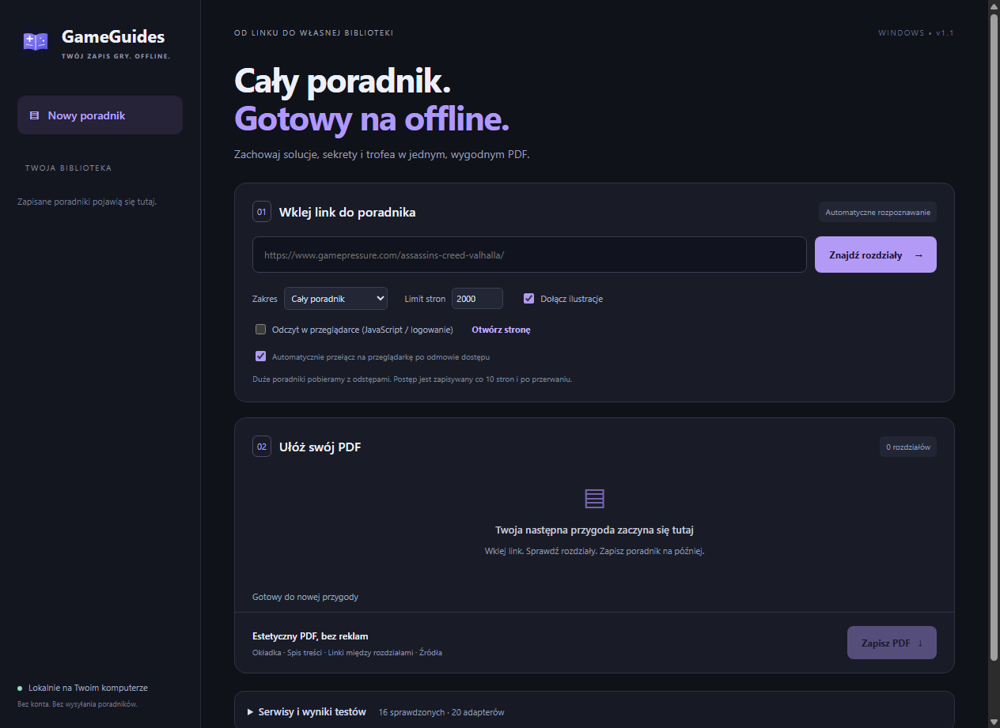

# GameGuides

Aplikacja Windows do zapisywania poradników do gier w estetycznym PDF. Wklej link, wybierz rozdziały i zapisz książkę offline. Polski interfejs, własna ikona, instalator ze skrótem na pulpicie oraz wersja portable.



## Pobieranie

Pobierz instalator **GameGuides-1.1.0-Setup.exe** lub wersję **Portable.exe** z [najnowszego wydania](https://github.com/pr3ston1989/GameGuides/releases/latest). Windows 10/11 x64; Node.js nie jest wymagany. Instalator pozwala wybrać katalog i tworzy skróty. Wydanie nie ma komercyjnego podpisu cyfrowego.

## Co nowego w 1.1

- 20 adapterów i jawne wyniki weryfikacji: 16 serwisów sprawdzonych na dwóch wylosowanych stronach; 4 nadal ograniczone.
- Automatyczne przełączenie na normalną przeglądarkę przy odmowie HTTP lub stronie wymagającej JavaScript.
- Zapisywanie postępu, wznowienie po przerwaniu/limicie i ponowienie błędnych stron.
- Filtr i zmiana kolejności rozdziałów, własny tytuł, A4/Letter, układ poziomy, tekst 9/11/13 pkt.
- Odsyłacze pomiędzy pobranymi rozdziałami działają w PDF; identyfikatory sekcji nie kolidują.
- Poprawki tabel Nintendo Life, treści Game8, obrazów IGN i pełnych opisów trofeów PlayStationTrophies.
- Wykrywanie uszkodzonych obrazów i ekranów weryfikacji, lokalny cache obrazów, działająca historia eksportów.

## Jak używać

1. Wklej link do strony głównej poradnika lub konkretnego artykułu.
2. Wybierz „Cały poradnik” lub „Tylko podana strona” i kliknij „Znajdź rozdziały”.
3. Sprawdź listę, filtruj ją, odznacz zbędne strony i ustaw kolejność strzałkami.
4. Ustaw tytuł, ilustracje i format papieru. Przy szerokich tabelach wybierz układ poziomy.
5. Kliknij „Zapisz PDF”. Obok pliku powstanie raport `.pdf.report.json` z adresami źródeł i ewentualnymi brakami.

Duże poradniki pobierane są kolejno, z odstępami; mogą wymagać kilkudziesięciu minut. Postęp jest zapisywany co 10 stron i na koniec, także po anulowaniu. „Wznów” odtwarza gotowe rozdziały i ponawia nieudane strony. Nowa analiza zastępuje poprzednią zapisaną sesję. Limit domyślny: 2000 stron, maksymalnie 5000. Po osiągnięciu limitu zwiększ go i wznów.

## Sprawdzone źródła

Zwykły HTTP: **IGN, PowerPyx, Gamepressure, GRYOnline, Gamer Guides, Samurai Gamers, Steam Community, Game8, Push Square, Nintendo Life, Eurogamer, GamesRadar+, PC Gamer**.

W przeglądarce: **PlayStationTrophies, Neoseeker, StrategyWiki**. Serwisy mogą zmieniać wymagania i czasowo blokować także ten tryb. W osobnym oknie możesz ręcznie zaakceptować cookies, zalogować się lub przejść weryfikację. Następnie użyj „Wznów”. Program nie automatyzuje CAPTCHA i nie odblokowuje płatnych treści. Sprawdza robots.txt także w trybie przeglądarkowym.

Adaptery, których nie udało się zweryfikować z powodu odmów/błędów: **GameFAQs, PSNProfiles, TrueAchievements, RPG Site**. Interfejs oznacza je jako ograniczone.

Każdy serwis sprawdzono na ograniczonej próbie, a nie na wszystkich poradnikach. Dokładne wylosowane adresy, gry, wyniki i ograniczenia są w [raporcie testów](docs/testing/REPORT.md). Testy obejmują również pełny poradnik GreedFall: **163 rozdziały, 425 stron PDF**, bez ilustracji.

## Zakres i ograniczenia

Wielostronicowe pobieranie: IGN, Gamepressure, GRYOnline, Neoseeker, StrategyWiki, Samurai Gamers, Gamer Guides, Game8, TrueAchievements. PowerPyx: główna strona trofeów i podstrony o wspólnym prefiksie gry. PlayStationTrophies: roadmap, wszystkie opisy trofeów i DLC na podanym adresie. Pozostałe serwisy: pojedynczy artykuł; nie łączymy automatycznie poradników do innych gier. Nieznane serwisy korzystają z uniwersalnego odczytu jednej strony.

„Cały poradnik” oznacza rozdziały znalezione przez dostępne linki w ustalonym zakresie gry. Strony niepodlinkowane, płatne, ukryte w niedostępnych menu lub blokowane mogą pozostać niewykryte. Pole `complete` w raporcie opisuje pobraną kolejkę i uwagi, a nie gwarantuje kompletności całego serwisu. Krótka strona startowa lub wpis społecznościowy może zawierać mało treści; program ostrzega o tym zamiast dopisywać tekst.

Wideo jest zastępowane linkiem; mapy interaktywne wymagają strony źródłowej. Obrazy: maksymalnie 5 MB na plik i 160 MB na eksport. Game8 podczas testu blokowało serwer ilustracji; tekst działał, a braki obrazów były raportowane. Obrazy wymagające cookies mogą być niedostępne, ponieważ pobiera je osobny klient HTTP.

## Dane lokalne

Historia, zapisana sesja pobierania, cookies przeglądarki i cache obrazów znajdują się w danych użytkownika GameGuides. Cache obrazów jest ważny przez 30 dni; przy starcie jest ograniczany do około 512 MB. Wznowienie używa już zapisanej treści; aby odświeżyć poradnik, rozpocznij nową analizę. Aplikacja łączy się bezpośrednio ze źródłami. Tryb przeglądarkowy wykonuje ich skrypty i ładuje ich zasoby. Nie ma serwera GameGuides otrzymującego poradniki.

## Rozwój i testy

Node.js 24 LTS, Windows x64:

```powershell
npm ci
npm test
npm run test:ui
npm run smoke
npm start
npm run build -- --publish never
```

Testy jednostkowe i test GUI nie wymagają sieci. Test GUI eksportuje prawdziwe PDF, weryfikuje ich wymiary i linki, testuje przerwanie/wznowienie oraz uszkodzone obrazy. Smoke uruchamia prawdziwy punkt startowy aplikacji i generuje przykładowy PDF oraz zrzut GUI. Instalator i portable trafiają do `dist/`.

Testy sieciowe i kontrola wizualna (wyniki w `output/`, nie są publikowane z kodem):

```powershell
npm run test:live
npm run test:browser
node scripts/recheck-samples.cjs
npm run test:pdf
npm run test:render
npm run test:full
node scripts/check-full-pdf.cjs
node scripts/test-report.cjs
```

Rendering podglądów wymaga Popplera (`pdftoppm`). Zmienne `SAMPLE_SITES`, `BROWSER_SAMPLE_SITES` i `QA_SITES` pozwalają ograniczyć test do nazw serwisów rozdzielonych przecinkami. `SAMPLE_SEED` zmienia deterministyczne losowanie. Przeglądarkowy sampler domyślnie sprawdza StrategyWiki. GitHub Actions wykonuje testy jednostkowe, GUI i startu oraz buduje instalator; tagi `v*` publikują wydania.

## Architektura

Electron, Cheerio i sanitize-html. Główne GUI ma izolację i nie wykonuje skryptów źródłowych. Czytnik ma osobną sesję, brak Node.js, blokadę uprawnień, pobierania plików i nowych okien. Klient HTTP sprawdza publiczne IP, przekierowania i przypina DNS do żądania. PDF ma CSP blokującą skrypty i zasoby sieciowe; obrazy są osadzane w dokumencie. W Windows wyłączono akcelerację sprzętową po wykryciu błędu renderowania podczas testów.

Kod: MIT. Poradniki i znaki serwisów należą do ich autorów; eksport zachowuje linki źródłowe i nie przenosi praw do treści.
